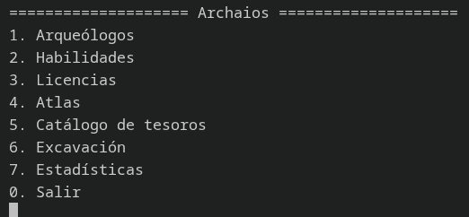
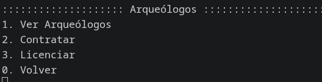
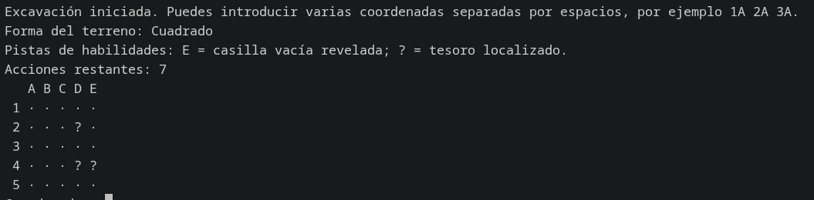

# Archaios - Manual de Usuario

Archaios es un videojuego de un jugador donde debes gestionar a varios arqueólogos y sus excavaciones en búsqueda de tesoros.

## Core Loop del Juego

El jugador inicia la partida con un arqueólogo. Este arqueólogo se podrá emplear para excavar en distintas regiones y obtener tesoros.

En cada excavación, el arqueólogo concreto que excavó adquiere puntos de experiencia. Los puntos de experiencia permiten subir de nivel al arqueólogo, obteniendo distintas habilidades con cada nivel.
Cuano un arqueólogo llega al nivel 5, obtiene una especialización en una región, lo cual le aporta beneficios en cada excavación de esa región.

Así mismo, en cada excavación, el jugador obtiene puntos. Estos puntos, a diferencia de la experiencia, son independientes de los arqueólogos, y pertenecen al jugador. Con estos puntos se puede contratar nuevos arqueólogos o adquirir licencias para los arqueólogos ya existentes.

## Inicio

Al iniciar Archaios, el juego buscará partida guardadas. Si hay alguna, podrás elegir entre cargar una partida existente o crear una partida nueva.

### Partida Nueva

En el momento de crear una partida nueva Archaios pedirá un código personal único, el cual sirve como identificador de la partida; nombre de la partida, el cual sirve como nombre del archivo de guardado; y el nombre del primer arqueólogo.

## Menú Principal

Una vez iniciado el juego, se presentará el menú principal con siete opciones:

### 1. Arqueólogos

Muestra un submenú donde se puede contratar, licenciar y ver los arqueólogos.

#### Ver Arqueólogos

Muestra una lista con los arqueólogos actualmente en posesión del jugador. Seleccionando un arqueólogo de la lista, se mostrarán todos los detalles de ese arqueólogo.

#### Contratar

Permite contratar nuevos arqueólogos siempre y cuando el jugador tenga puntos suficientes.

#### Licenciar

Permite licenciar un arqueólogo, es decir deshacerse de él, a cambio de puntos para el jugador.

### 2. Habilidades

Permite ver todas las habilidades existentes en el juego, con sus efectos y mejoras. Están clasificadas por tipos.

### 3. Licencias

Permite la compra de licencias para los arqueólogos ya disponibles. Las licencias permiten acceder a nuevas regiones.

### 4. Atlas

Permite consultar todas las regiones disponibles en el juego, y la información de los distintos tipos de tesoros de dicha región.

### 5. Catálogo de Tesoros

Permite consultar una lista completa de todos los tesoros disponibles de cada región.

### 6. Excavación

Inicia la excavación. Se preguntará el arqueólogo que realizará la excavación, la región en la que se realizará, y el tamaño del terreno de excavación.

El jugador tendrá un número limitado de veces en las que puede excavar. Se deberá introducir la casilla para excavar introduciendo la coordenada, primero el número y luego la letra. Se pueden concatenar distintas coordenadas separadas por espacios.

Una misma casilla no se puede excavar varias veces en la misma excavación.

Al final de la excavación se mostrarán los tesoros adquiridos, la experiencia ganada, y los puntos adquiridos.

Si el arqueólogo sube de nivel, el jugador elegirá que habilidad obtendrá el arqueólogo.

### 7. Estadísticas

Permite ver las estadísticas tanto de las regiones como de los tesoros.

#### Ver Regiones

Permite ver el número de veces que una región fe visitada, el número de tesoros únicos encontrados de dicha región, y el número total de tesoros excavados.

#### Ver Tesoros

Permite ver una lista de los tesoros totales adquiridos en las distintas excavaciones.